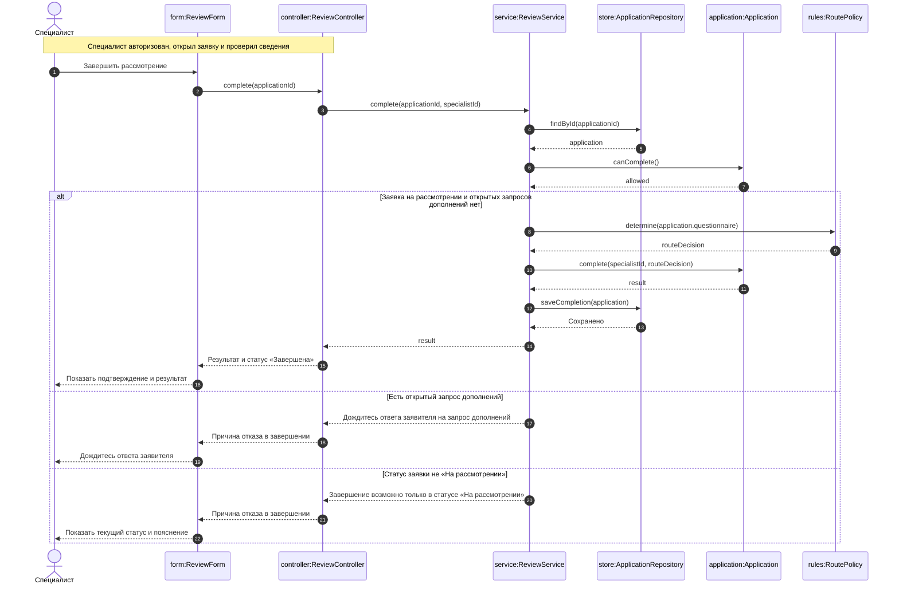

# Лабораторная работа 4 Диаграмма последовательностей на уровне классов

## Выбранный юзкейс

**«Завершить рассмотрение и выдать результат»**. Специалист завершает проверку заявки, система определяет маршрут трудоустройства по пунктам 4.1–4.2 и сохраняет результат.

## Объекты и ответственность

| Объект | Назначение |
| --- | --- |
| form:ReviewForm | Передаёт команду специалиста и показывает ответ. |
| controller:ReviewController | Принимает команду и вызывает сервис. Идентификатор специалиста получает из текущего сеанса. |
| service:ReviewService | Организует загрузку заявки, проверку, определение маршрута и сохранение. |
| store:ApplicationRepository | Загружает заявку из БД и сохраняет изменения. |
| application:Application | Проверяет возможность завершения, формирует результат и изменяет статус заявки. |
| rules:RoutePolicy | Определяет маршрут, дальнейшее действие и срок по данным анкеты. |

Запись «имя:Класс» обозначает объект класса. Сплошные стрелки — вызовы методов, пунктирные — ответы. Диаграмма читается сверху вниз. Блок alt/else показывает выдачу результата либо одну из причин, по которой завершение недоступно. Если есть открытый запрос дополнений, сначала показывается сообщение об ожидании ответа; иначе проверяется неподходящий статус.

## Предусловия

Специалист авторизован, открыл заявку и проверил сведения и документы. Вход и проверка роли находятся за пределами выбранного юзкейса. Идентификатор автора решения определяется по сеансу, а не задаётся пользователем в форме.

## Последовательность действий

1. Специалист нажимает «Завершить рассмотрение». Форма передаёт номер заявки контроллеру, контроллер вызывает сервис.
2. Сервис загружает открытую заявку Application через репозиторий.
3. Метод canComplete() проверяет, что заявка находится в статусе «На рассмотрении» и открытых запросов дополнений нет. Иначе завершение не выполняется.
4. RoutePolicy.determine() определяет маршрут по анкете: гражданству, дате въезда, статусу высококвалифицированного специалиста, членству в его семье и участию в программе переселения.
5. Application.complete() создаёт результат с указанием специалиста, устанавливает статус «Завершена» и добавляет запись истории. Пока эти изменения подготовлены в памяти, но не сохранены в БД.
6. Репозиторий сохраняет изменения. При успехе ответ возвращается через сервис и контроллер форме, специалист видит подтверждение и результат.

## Правила выбора маршрута

- **4.2:** высококвалифицированный специалист или член его семьи — трудоустроиться по трудовому договору или договору гражданско-правового характера в течение 2 месяцев со дня въезда в РФ.
- **4.1:** гражданство Азербайджана, Таджикистана, Узбекистана, Молдовы или Украины; нет статуса высококвалифицированного специалиста и участия в программе переселения — перейти к подготовке документов и подаче заявления на патент. Подать заявление в течение 30 дней со дня въезда.
- Если ни одно условие не подходит, результат содержит объяснение, что случай не охвачен разделом 4, без выбранного маршрута.

При пересечении условий сначала проверяется пункт 4.2. Значение routeDecision содержит выбранный маршрут либо объяснение неприменимости, дальнейшее действие и срок.

## Результат

После успешного завершения в БД сохраняются результат с указанием выдавшего его специалиста, статус «Завершена» и запись истории. Заявителю результат доступен в личном кабинете.

Если есть открытый запрос дополнений, специалист получает сообщение «Дождитесь ответа заявителя». Если открытых запросов нет, но статус не «На рассмотрении», показывается текущий статус и сообщение «Завершение возможно только в статусе “На рассмотрении”». Например, уже завершённую заявку нельзя завершить повторно. В обоих случаях результат, статус и история не изменяются. Закрепление заявки за конкретным специалистом не предусмотрено.

Подготовка документов на патент, выдача патента и заключение договора выполняются за пределами сервиса.
