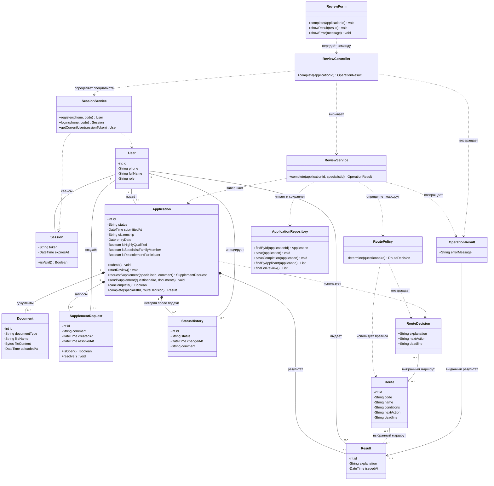

# Лабораторная работа 5 Диаграмма классов приложения

## Назначение

Диаграмма описывает классы сервиса выбора порядка трудоустройства по пунктам 4.1–4.2 дорожной карты: пользователей, заявки, подтверждающие документы, запросы дополнений, маршруты и результаты. Подробно показано взаимодействие классов, участвующих в выдаче результата из четвёртой лабораторной.

Знак «−» обозначает закрытое поле, «+» — публичный метод. Сплошные линии показывают связи объектов, ромб — принадлежность частей заявке, пунктирные стрелки — использование одного класса другим. Кратности указывают количество связанных объектов. Состав заявки сохраняется и после завершения услуги.

## Ответственность классов

| Класс | Назначение |
| --- | --- |
| User | Учётная запись. Роль принимает значения APPLICANT или SPECIALIST. Отдельные классы для двух ролей не требуются. |
| SessionService, Session | Регистрация и вход по телефону с кодом 123456, определение текущего пользователя. Сеанс связывается с пользователем и имеет срок действия. Публичная регистрация создаёт только заявителя; специалист создаётся заранее. |
| Application | Заявка с данными анкеты. Управляет подачей, началом рассмотрения, запросом и приёмом дополнений, завершением и историей статусов. |
| Document | Подтверждающий документ с содержимым файла. Полный комплект для оформления патента здесь не собирается. |
| SupplementRequest | Замечания специалиста. До ответа заявителя запрос открыт, после принятия дополнений закрывается методом resolve(). |
| StatusHistory | Запись о статусе, времени, инициаторе изменения и комментарии. |
| Route | Один из двух маршрутов: условия, дальнейшее действие и срок. |
| Result | Итог рассмотрения, его автор, дата и объяснение. Ссылка на маршрут может отсутствовать, если случай не охвачен заданием. |
| ReviewForm | Экран специалиста: отправляет команду завершения и показывает результат или пояснение. |
| ReviewController | Принимает команду, получает текущего специалиста через SessionService и вызывает ReviewService. |
| ReviewService | Загружает заявку, проверяет возможность завершения, вызывает правила выбора маршрута и сохраняет результат через репозиторий. |
| RoutePolicy | Применяет условия пунктов 4.1–4.2 к сведениям анкеты. |
| ApplicationRepository | Загружает и сохраняет заявки с их документами, запросами, результатом и историей. Возвращает список заявок заявителя и список для специалиста. |

## Основные операции

1. **Подача.** Метод submit() проверяет обязательные сведения анкеты, устанавливает статус «Подана» и добавляет первую запись истории. Заявка сохраняется методом save().
2. **Рассмотрение.** startReview() переводит поданную заявку в статус «На рассмотрении» и добавляет запись истории.
3. **Запрос дополнений.** requestSupplement() создаёт запрос специалиста, устанавливает статус «Требует дополнения» и фиксирует переход в истории. Метод доступен для заявки на рассмотрении.
4. **Ответ заявителя.** sendSupplement() проверяет исправленные сведения и документы, обновляет анкету, закрывает запрос и возвращает заявку в статус «На рассмотрении». При ошибках сведения не принимаются и статус не меняется.
5. **Завершение.** canComplete() проверяет статус «На рассмотрении» и отсутствие открытых запросов. RoutePolicy.determine() формирует решение, а Application.complete() создаёт Result с автором, устанавливает статус «Завершена» и добавляет запись истории. saveCompletion() сохраняет эти изменения совместно.
6. **Просмотр.** findByApplicant() возвращает заявки только указанного заявителя. По ним доступны результат, история статусов и ранее оказанные услуги. findForReview() возвращает список заявок для специалиста. Назначение заявки конкретному специалисту не предусмотрено.

Контроллер получает идентификатор специалиста из сеанса, а не из данных формы. Перед операциями проверяются роль и права: заявитель работает только со своими заявками, специалист выполняет рассмотрение. В диаграмме подробно показана форма завершения; однотипные формы подачи, дополнения и просмотра отдельно не перечислены.

## Правила определения маршрута

- **4.2:** высококвалифицированный специалист или член его семьи — трудоустроиться по трудовому договору или договору гражданско-правового характера в течение 2 месяцев со дня въезда в РФ.
- **4.1:** гражданство Азербайджана, Таджикистана, Узбекистана, Молдовы или Украины; нет статуса высококвалифицированного специалиста и участия в программе переселения — перейти к подготовке документов и подаче заявления на патент. Подать заявление в течение 30 дней со дня въезда.
- Сначала проверяется пункт 4.2. Если оба пункта неприменимы, создаётся результат с объяснением без выбранного маршрута.

## Обозначения данных и ограничения

questionnaire — набор полей анкеты, хранящихся в Application, а не отдельная сущность. RouteDecision и OperationResult передают данные между методами. RouteDecision содержит ссылку на выбранный маршрут, действие и срок. Если маршрут не определён, ссылка, действие и срок отсутствуют, а explanation содержит причину. OperationResult содержит либо ссылку на выданный Result при успехе, либо errorMessage при невозможности завершения. Эти типы используются внутри приложения и не требуют отдельных таблиц. List — список объектов. Язык программирования и СУБД этой диаграммой не задаются.

Если есть открытый запрос, завершение отклоняется с сообщением «Дождитесь ответа заявителя». Если запросов нет, но статус другой, показывается «Завершение возможно только в статусе “На рассмотрении”». Уже завершённая заявка не получает второй результат. Текущий статус соответствует последней записи истории; изменённая заявка и связанные записи сохраняются совместно. Все данные, включая содержимое документов и сеансы, сохраняются в БД.
