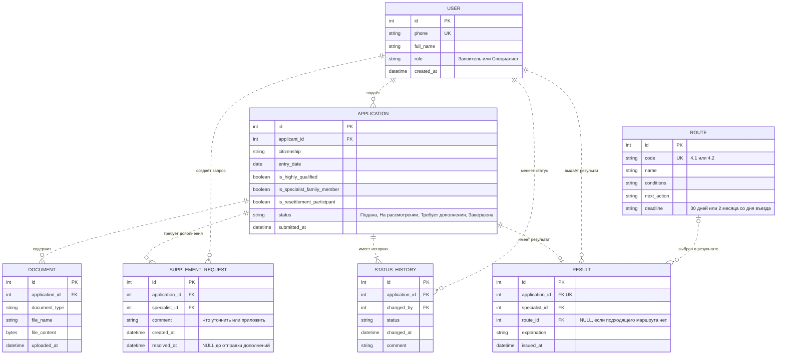

# Лабораторная работа 2 ER-диаграмма

## Пояснения

Модель описывает сервис выбора порядка трудоустройства по пунктам 4.1–4.2 дорожной карты. Заявитель заполняет анкету и подаёт заявку, специалист проверяет сведения и выдаёт маршрут с дальнейшими действиями и сроками. Подготовка комплекта на патент, выдача патента и заключение договора в эту тему не входят.

### Сущности

- **USER** — пользователь системы. Поле role различает заявителя и специалиста. Регистрация и вход выполняются по телефону с учебным кодом 123456. Коды и сеансы входа не показаны, поскольку это технические данные авторизации.
- **APPLICATION** — заявка на выбор порядка трудоустройства. В ней сразу хранятся данные анкеты: гражданство, дата въезда, статус высококвалифицированного специалиста, членство в его семье и участие в программе переселения. Отдельная сущность анкеты не требуется.
- **DOCUMENT** — документ, подтверждающий сведения заявки. Прикладывается при необходимости, в том числе по запросу специалиста. Содержимое файла сохраняется в БД.
- **SUPPLEMENT_REQUEST** — запрос специалиста на уточнение сведений или приложение подтверждений. После отправки дополнений заявителем запрос закрывается: заполняется resolved_at.
- **STATUS_HISTORY** — история статусов заявки: статус, дата, пользователь, вызвавший изменение, и комментарий. Поле APPLICATION.status хранит текущий статус.
- **ROUTE** — справочник двух маршрутов из задания: условия применимости, дальнейшее действие и срок.
- **RESULT** — итог рассмотрения заявки. Содержит выбранный маршрут, пояснение и автора решения. Если случай не охвачен пунктами 4.1–4.2, маршрут не указывается, а причина записывается в explanation.

### Связи

- Один заявитель может подать несколько заявок; каждая заявка принадлежит одному заявителю.
- У заявки может быть несколько документов и запросов дополнений или ни одного. Каждый запрос создаёт один специалист.
- У поданной заявки есть хотя бы одна запись истории — подача. Каждое последующее изменение статуса добавляет новую запись.
- До завершения заявки результата нет; после завершения есть один результат, выданный специалистом.
- Один маршрут может использоваться в нескольких результатах. В каждом результате выбран не более чем один маршрут.

### Маршруты по заданию

| Пункт | Условия | Действие и срок |
| --- | --- | --- |
| 4.1 | Гражданство Азербайджана, Таджикистана, Узбекистана, Молдовы или Украины; нет статуса высококвалифицированного специалиста и участия в программе переселения. | Перейти к подготовке документов и подаче заявления на патент. Подать заявление в течение 30 дней со дня въезда. |
| 4.2 | Высококвалифицированный специалист или член его семьи. | Трудоустроиться по трудовому договору или договору гражданско-правового характера в течение 2 месяцев со дня въезда в РФ. |

При пересечении условий сначала применяется пункт 4.2, как принято в первой лабораторной. Если ни один пункт не подходит, результат содержит объяснение без выбранного маршрута.

### Основные ограничения

PK — первичный ключ, FK — внешний ключ, UK — уникальное значение. Пунктирные линии показывают связи, при которых ключ родителя не входит в первичный ключ потомка.

Заявки подают только заявители; запросы дополнений и результаты создают только специалисты. Заявитель просматривает только свои обращения. Изменение заявки после подачи допускается по запросу специалиста. Текущий статус совпадает с последней записью истории. После завершения заявка и результат сохраняются для просмотра ранее оказанных услуг; отдельная сущность архива не нужна.
