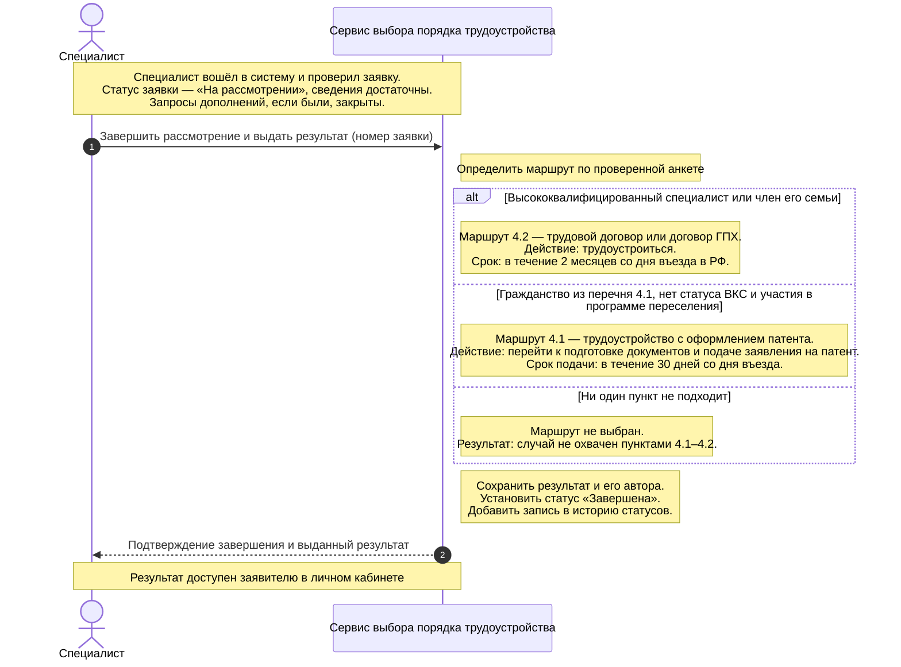

# Лабораторная работа 3 Системная диаграмма последовательностей

## Выбранный юзкейс

**«Завершить рассмотрение и выдать результат»**. Специалист завершает проверку заявки, а система формирует результат выбора порядка трудоустройства по пунктам 4.1–4.2 дорожной карты.

## Участники

- **Специалист** — проверяет сведения заявителя и инициирует завершение рассмотрения.
- **Сервис выбора порядка трудоустройства** — определяет маршрут по анкете, сохраняет результат и историю статусов.

Система представлена как единое целое, без внутренних классов. Заявитель не участвует в выбранном сценарии напрямую: он подал сведения ранее, а просмотрит выданный результат отдельным действием.

## Предусловия

Специалист вошёл в систему и проверил заявку. Заявка находится в статусе «На рассмотрении». Необходимые уточнения получены, открытых запросов дополнений нет. В анкете указаны гражданство, дата въезда, статус высококвалифицированного специалиста, принадлежность к его семье и участие в программе переселения.

## Последовательность действий

1. Специалист отправляет команду «Завершить рассмотрение и выдать результат», указав номер заявки.
2. Система определяет подходящий маршрут по проверенным сведениям анкеты. Сначала проверяется условие пункта 4.2, затем пункта 4.1.
3. Для выбранного маршрута система формирует дальнейшее действие и срок из дорожной карты. Если ни один маршрут не подходит, формирует объяснение.
4. Система сохраняет результат с указанием специалиста, устанавливает статус «Завершена» и добавляет запись в историю статусов.
5. Специалист получает подтверждение завершения и выданный результат. Заявителю результат становится доступен в личном кабинете.

## Варианты результата

| Условие | Результат услуги |
| --- | --- |
| Заявитель — высококвалифицированный специалист или член его семьи | Маршрут 4.2: трудоустроиться по трудовому договору или договору гражданско-правового характера в течение 2 месяцев со дня въезда в РФ. |
| Заявитель — гражданин Азербайджана, Таджикистана, Узбекистана, Молдовы или Украины; нет статуса высококвалифицированного специалиста и участия в программе переселения | Маршрут 4.1: перейти к подготовке документов и подаче заявления на патент. Подать заявление в течение 30 дней со дня въезда. |
| Ни одно условие не выполнено | Результат с объяснением, что случай не охвачен пунктами 4.1–4.2, без выбранного маршрута. Это не отказ в праве на трудоустройство. |

При пересечении условий приоритет имеет пункт 4.2: член семьи высококвалифицированного специалиста получает этот маршрут независимо от гражданства. Такой порядок принят в модели команды.

## Итог сценария

Рассмотрение завершено, результат и изменение статуса сохранены. Заявитель может просмотреть результат и историю статусов. Подготовка документов на патент и заключение договора здесь не выполняются: сервис только сообщает дальнейшие действия и сроки.
